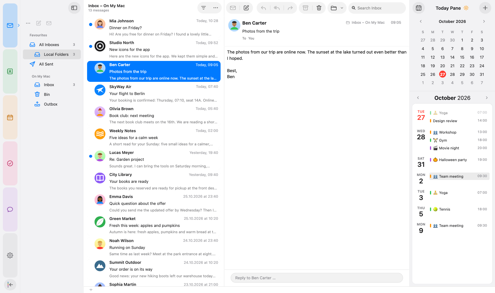
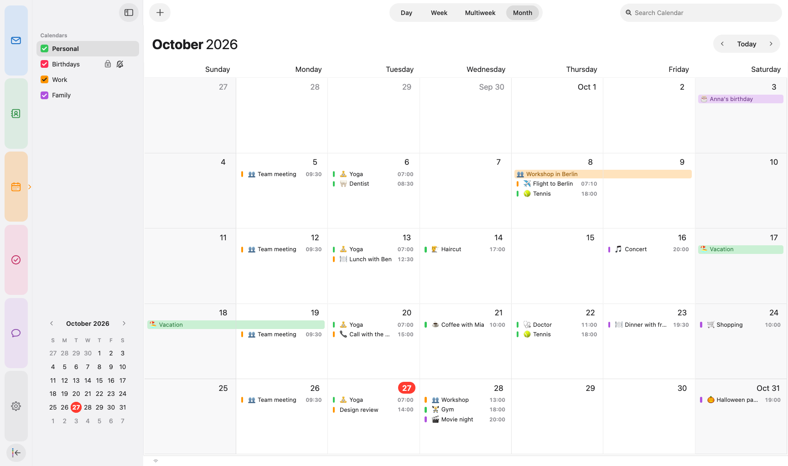
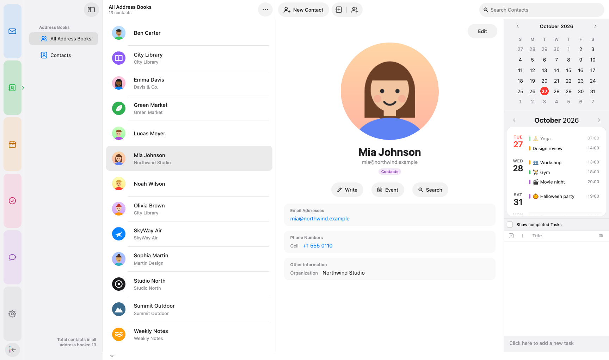
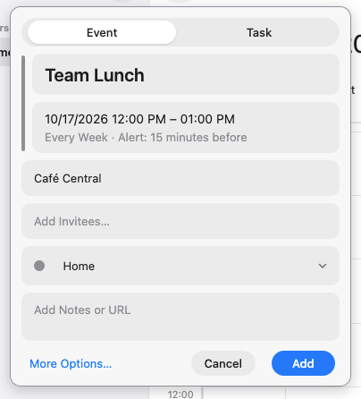

# halo.spaces

<p align="center">
  
</p>

halo.spaces gives Mozilla Thunderbird on macOS a calm, tidy look inspired by
Apple Mail, Calendar and Contacts. It adds coloured spaces on the left and
uses the same layout in every space.

It is one package for Thunderbird 128+: the theme, its own Apple-style icons,
and an extension for the things CSS alone can't do.

Released under the Mozilla Public License 2.0

<p align="center">
  
</p>

---------------------------------------------------------------

Features
--------
- **Apple Mail layout**: card list with a two-line preview, sender logos (address book, macOS Contacts, BIMI, website icon, otherwise initials), unified inboxes and the search field top right
- **Coloured spaces**: Mail, Contacts, Calendar, Tasks and Chat, all with the same toolbar and sidebar edges. Sidebars slide in and out, and a double-click on a divider resets it
- **Calendar like Apple Calendar**: Day, Week, Multiweek and Month switcher in the title bar, a month view without scrollbars, and a **quick event/task window** for new entries
- **Today pane**: runs to the top of the window, has a mini calendar plus an agenda card to the end of the month, and marks upcoming events with "now" or "in 2 hr"
- **Unified address book**: duplicates merged, account labels in the account colours
- **Light and dark** follow the system, and the accent colour follows macOS
- No scrollbars anywhere. Scrolling still works with the wheel, trackpad and keyboard
- Automatic updates via GitHub

<p align="center">
  
  
</p>

<p align="center">
  
</p>

Personal data in the screenshots is blurred.

3.5.0 Release Notes
--------
- **Whole conversations like Apple Mail**: selecting a message shows the entire conversation – received mails and your own replies from Sent, newest first, each one in full. Collapsed threads show the same instead of a text summary. Can be turned off in Settings → halo.spaces
- **Settings → halo.spaces**: all options now live in Thunderbird's settings. Account Settings and Add-ons and Themes open there too, with the sidebar staying in place; the help window links to it. New installs get a short welcome and are switched to *System theme – auto*
- **Search like Apple Mail**: the search field searches the selected folder, a unified folder searches all mailboxes; switching folders keeps searching there, and the placeholder says where ("Search Sent", "Search Calendar" …). Scrolling through results stays smooth while previews load
- **Message list**: card view, classic table or wide table in one menu; optional light accent tint behind unread mail; the time no longer touches the edge of the selection; quick filter labels no longer overlap their icons; folders light up while you drag mail onto them; the Unsubscribe button disappears once you have unsubscribed
- **Events like Apple Calendar**: the event window is laid out like Apple Calendar – title on top, then cards for all-day, start, end, repeat and alert, location, invitees and calendar, with "Add Notes or URL" at the bottom and a stripe in the calendar's colour. Clicking the date shows only a date picker, clicking the time only a small time popover; the mouse wheel changes hours and minutes; changing the start keeps the duration, as in Apple Calendar. The "Invite Attendees" window is restyled
- **Tasks**: the filters (Current Tasks, Today, Next Seven Days …) moved into a menu next to the search field, like the mail Quick Filter; the button turns accent-coloured while another filter is active
- **Contacts**: cards show only name or company, sized like the mail cards; the photo window works like Apple Contacts – choose a different picture any time, round crop, zoom slider
- **Everywhere**: the sidebar slides in and out smoothly in every space; "Increase contrast" in the macOS accessibility settings is respected; optional design loading before the first window, so the old look never flashes at start
- **Settings**: Account Settings and Add-ons appear as indented sub-entries in the settings sidebar instead of a second grey column
- **Context menus**: "Open in New Tab" and "Open in New Window" are gone everywhere, so menus are shorter
- The sidebar no longer jerks at the end of its animation in Mail; the online icon in the status bar sits in the same place in every space; opening a conversation no longer briefly flashes Thunderbird's own view
- Account settings no longer go blank when the sidebar is hidden

See [Releases](https://github.com/sruf79/halo-spaces/releases) for all versions.

Credits
--------
halo.spaces uses the coffee cup from [Noto Emoji](https://github.com/googlefonts/noto-emoji)
(© Google LLC, Apache License 2.0) – see `extension/about/NOTICE.txt`.
The layout of this page follows [FluentBird](https://github.com/Deathbyteacup/fluentbird) by Danny King.

---------------------------------------------------------------

Setup Instructions
------------------

1. Download the latest `halo-spaces-<version>.xpi` from
   [Releases](https://github.com/sruf79/halo-spaces/releases).

2. In Thunderbird open **Add-ons and Themes** → gear icon →
   **Install Add-on From File…** and choose the file.

3. That's it. On first install halo.spaces sets **Themes** to **System theme – auto**
   (Thunderbird's default), so light and dark follow macOS. Thunderbird's Light or
   Dark stay if you chose one; themes from the add-on store paint their own colours
   over the design.

No restart is needed – the design is active right away.

Updates arrive automatically (Thunderbird checks every 24 hours). To check
right away: **Help → halo.spaces… → Check for Updates**.

No `userChrome.css` is needed. The theme ships inside the extension. An older
copy of this theme in your profile's `chrome` folder takes precedence and
would hide updates, so remove it.

---------------------------------------------------------------

Known Issues
------------
- Made for **macOS**. Windows and Linux work, but they aren't the focus.
  Window buttons and some spacing differ there, and you'll see a short note
  on first start.
- The compose window and a few dialogs are only partly themed.
- Report issues via [GitHub Issues](https://github.com/sruf79/halo-spaces/issues). Please include your OS, Thunderbird version and a screenshot.

Options
-------
All options of halo.spaces – preview lines, hover actions, sender logos,
photos from the Contacts app, calendar emojis, birthdays, the bundled design
and icons, updates – are in **Settings → halo.spaces** (also reachable via
**Help → halo.spaces… → Settings…** or **Add-ons and Themes → halo.spaces →
Settings**). Changes take effect right away unless noted.

---------------------------------------------------------------

Development
-----------

| Folder/File | Content |
|---|---|
| `chrome/userChrome.css` | theme (mail, menus, dialogs) |
| `chrome/spaces.css` | calendar, tasks, contacts, chat, settings – merged in by `chrome/merge_spaces.py` |
| `icons/` | toolbar, folder and `--icon-*` replacement icons |
| `extension/` | the extension (manifest, `api/implementation.js`) |

```bash
./build.sh                       # → dist/halo-spaces-<version>.xpi (includes theme.css)
python3 tests/halo_test.py       # automated checks in a fresh, temporary profile
./release.sh 3.1.0               # version, update URL, runs the tests, writes updates.json
./publish.sh 3.1.0 notes.md      # uploads exactly that package and verifies the hash
```

---------------------------------------------------------------

Questions or feedback?
In Thunderbird: **Help → halo.spaces… → Send Feedback**, or open an issue here. Enjoy!
