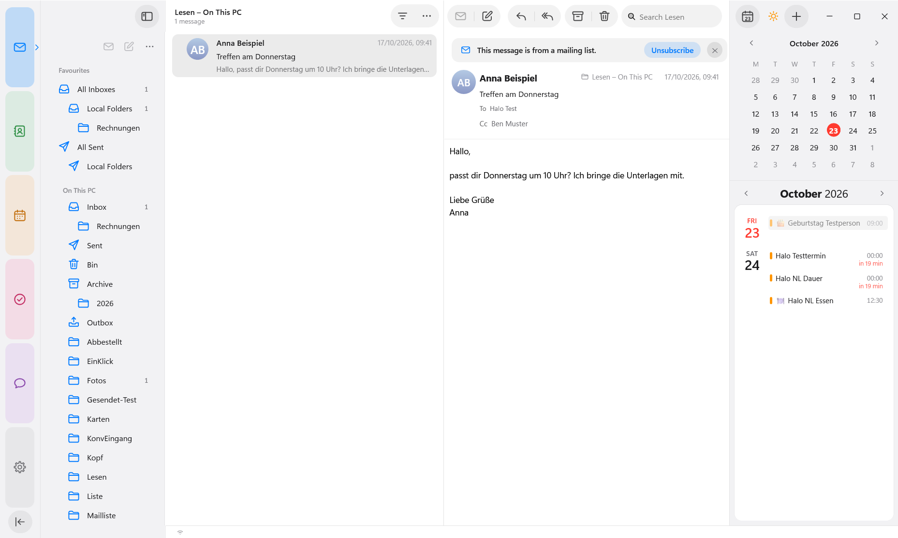
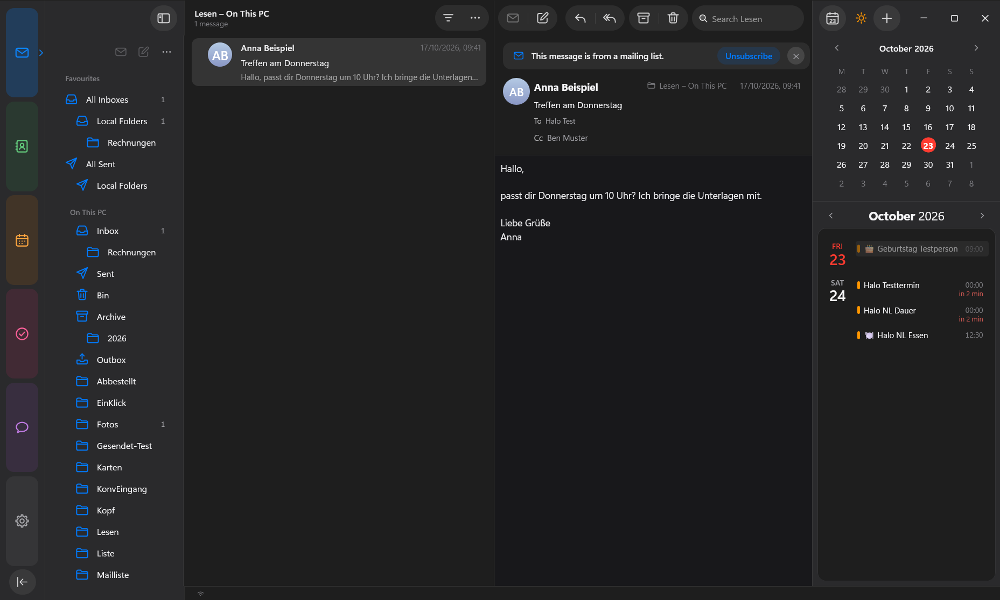
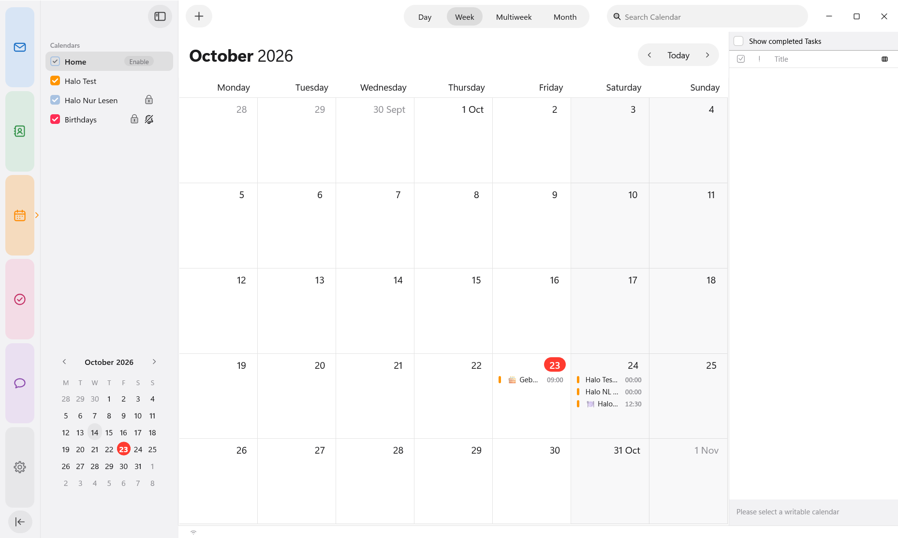
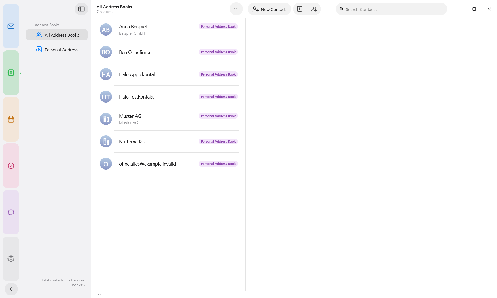

# halo.spaces for Windows

<p align="center">
  
</p>

A Windows port of [halo.spaces](https://github.com/sruf79/halo-spaces), the calm, tidy design for
Mozilla Thunderbird inspired by Apple Mail, Calendar and Contacts. The original is made and tuned on
macOS. This fork adjusts it so Thunderbird on **Windows 11** looks and behaves the same as it does there.

It is one package for Thunderbird 128+: the theme, its own Apple-style icons, and an extension for the
things CSS alone can't do.

Released under the Mozilla Public License 2.0, like the original.

<p align="center">
  
</p>

<p align="center">
  
</p>

---------------------------------------------------------------

Features
--------
- **Apple Mail layout**: card list with a two-line preview, sender logos (address book, BIMI, website icon, otherwise initials), unified inboxes and the search field top right
- **Coloured spaces**: Mail, Contacts, Calendar, Tasks and Chat, all with the same toolbar and sidebar edges. Sidebars slide in and out; dragging a divider all the way closes the sidebar, a double-click resets its width
- **Calendar like Apple Calendar**: Day, Week, Multiweek and Month switcher in the title bar, a month view without scrollbars, and a **quick event/task window** for new entries
- **Today pane**: runs to the top of the window, has a mini calendar plus an agenda card to the end of the month, and marks upcoming events with "now" or "in 2 hr"
- **Unified address book**: duplicates merged, account labels in the account colours
- **Light and dark** follow Windows, and the accent colour follows your Windows accent colour
- No scrollbars anywhere. Scrolling still works with the wheel, touchpad and keyboard

<p align="center">
  
  
</p>

What this fork changes for Windows
-----------------------------------
- **Font**: Segoe UI Variable, Windows 11's UI font and the closest match to Apple's SF Pro. Windows 10 falls back to Segoe UI
- **Menus like the Mac**: the ≡ menu button is hidden, as on macOS. Press **Alt** for the menu bar (File, Edit, View …), shown as a full-width strip at the top of the window, which also works in the compose and event windows. ≡ comes back by itself when Thunderbird has something to tell you, such as an update that needs a restart
- **Today pane**: its top strip leaves room for the Windows minimise, maximise and close buttons, so the title and the "+" never overlap them
- **Folder pane**: the Get Messages, New Message and "…" buttons sit at the right in the intended order (newer Thunderbird versions mirrored them)
- **Event window**: "Add Location or Video Call" spans the whole card instead of being cut off by the wider Windows font
- **Help window** (Help → halo.spaces…) sizes itself to its content, also at 125 % and 150 % display scaling
- **Settings → Appearance** says "follow Windows" instead of "follow macOS". The macOS-only option (photos from the Contacts app) is hidden
- **Local folders** are titled "On This PC" (like Windows' "This PC") instead of "On My Mac"
- **Favourites**: Settings → halo.spaces → Mail can show all unified folders (Drafts, Trash, Spam, Archives …), not only All Inboxes and All Sent
- **Space arrow**: the arrow next to the current space no longer shows a thin bar at 125 % and 150 % display scaling
- No "made for macOS" notice, and no feedback or donation buttons
- Updates come from this repository, never from the macOS original

Setup Instructions
------------------

### One click: `halo-spaces.cmd`

Double-click **`halo-spaces.cmd`** in this folder and press **1** to install (or update) or **2** to
uninstall. It finds the Thunderbird profile you use and builds a fresh package first if Python 3 is
installed. If Thunderbird is open, it asks you to close it and waits.

- After a first install, start Thunderbird. If it asks whether to enable halo.spaces, choose **Enable**.
- Uninstall removes the add-on, plus the `userChrome.css` that halo.spaces itself wrote for the
  "Design without flicker at start" option. Your own `userChrome.css` is never touched.

### By hand

1. Get `halo-spaces-<version>.xpi`: download it from this repo's
   [Releases](https://github.com/ahXN00/halo-spaces_win/releases), or build it yourself (see
   [Development](#development)).

2. In Thunderbird open **Alt → Tools → Add-ons and Themes**, click the gear icon,
   choose **Install Add-on From File…**, and pick the file. No restart is needed.

Either way, on first install halo.spaces sets **Themes** to **System theme – auto**, so light and dark
follow Windows. Thunderbird's Light or Dark stay if you chose one. Themes from the add-on store paint their
own colours over the design.

> If you used the original halo.spaces before, install this file over it. It uses the same add-on ID,
> so your settings stay. From then on, updates come from this fork.

No `userChrome.css` is needed, because the theme ships inside the extension. An older copy of this theme
in your profile's `chrome` folder takes precedence and would hide updates, so remove it.

Options
-------
All options (preview lines, hover actions, sender logos, calendar emojis, birthdays, the bundled design
and icons, updates) are in **Settings → halo.spaces**. You can also reach them from
**Alt → Help → halo.spaces… → Settings…** or **Add-ons and Themes → halo.spaces → Settings**.
Changes take effect right away unless noted.

Known differences from macOS
----------------------------
- The Windows minimise, maximise and close buttons take up the top right of the Today pane. When the
  pane is narrow, its title shrinks to just the ☀ symbol.
- Dialog labels show Windows' keyboard-shortcut underlines (for example the "S" in "Start").
- Dialogs keep the normal Windows title bar. The Mac's title-bar-less "card" dialogs would hide the
  Windows close button.
- The compose window and a few dialogs are only partly themed (the same as on macOS).

---------------------------------------------------------------

Development
-----------

| Folder/File | Content |
|---|---|
| `chrome/userChrome.css` | theme (mail, menus, dialogs) |
| `chrome/spaces.css` | calendar, tasks, contacts, chat, settings – merged into `userChrome.css` by `chrome/merge_spaces.py` on every build |
| `icons/` | toolbar, folder and `--icon-*` replacement icons |
| `extension/` | the extension (manifest, `api/implementation.js`) |
| `build.py` | builds the package on Windows (no zsh or zip needed) |
| `halo-spaces.cmd`, `tools/install.ps1` | one-click install, update and uninstall in your Thunderbird profile |
| `CHANGELOG.md` | what this fork changed |
| `tests/halo_test.py` | automated checks in a fresh, temporary Thunderbird profile |

Needs Python 3 and Thunderbird installed at `C:\Program Files\Mozilla Thunderbird`.

```bash
python build.py                                   # → dist/halo-spaces-<version>.xpi
python tests/halo_test.py --port 2851             # all checks, light (builds first)
python tests/halo_test.py --port 2851 --dark --xpi dist/halo-spaces-<version>.xpi
python tests/halo_test.py --port 2851 --only "Calendar|Kalender" --shots tests/shots/x
```

The tests never touch your own Thunderbird profile: each run creates an empty temporary profile and
deletes it afterwards. A Thunderbird window opens during the run, so leave it alone until it finishes.

Credits
-------
halo.spaces is made by the author of [sruf79/halo-spaces](https://github.com/sruf79/halo-spaces); this
fork only adapts it for Windows. The layout of the original's README follows
[FluentBird](https://github.com/Deathbyteacup/fluentbird) by Danny King.
